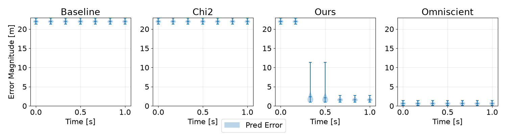

# s3_speedy_ss



Code for our speedy solution separation (S3) algorithm. Using our novel ordering to find fault-free measurement subsets, we can quickly find near-optimal solutions with large numbers of measurements and faults. The image above shows our method is nearly able to have the same error as an omniscient estimator even with over 60 measurements and 25 faults.

Code is only verified to work on Ubuntu 24.04. The `requirements.txt` file shows versions of imported packages.

The main SS-FDE algorithm can be found in `ssfde.py`. When running locally, if one does not already exist, create a `data` directory within the repo before running any test. Simulation results will save to this directory

## Numerical Simulations

To evaluate ssfde implementations against random linear models, run

```
python3 -m pytest test/test_ssfde -k all
```

Other tests in `test/test_ssfde.py` look at using different bounds to accelerate SS tests. It is OK if these tests do not pass (they will only pass if SS-FDE perfectly removes all faults). They will pass sometimes, but not everytime.

To load previous data for plotting, change the `LOAD_DATA` global variable to `True` and update the `DATA_TIMESTAMP` to the desired timestamp.

Changing the global variables at the top of `test_ssfde.py` will change the parameters for all tests in `test_ssfde.py`.

## Real Data

To evaluate ssfde implemenations on real-world data from the UrbanNav dataset, run

```
python3 run_evaluate.py
```